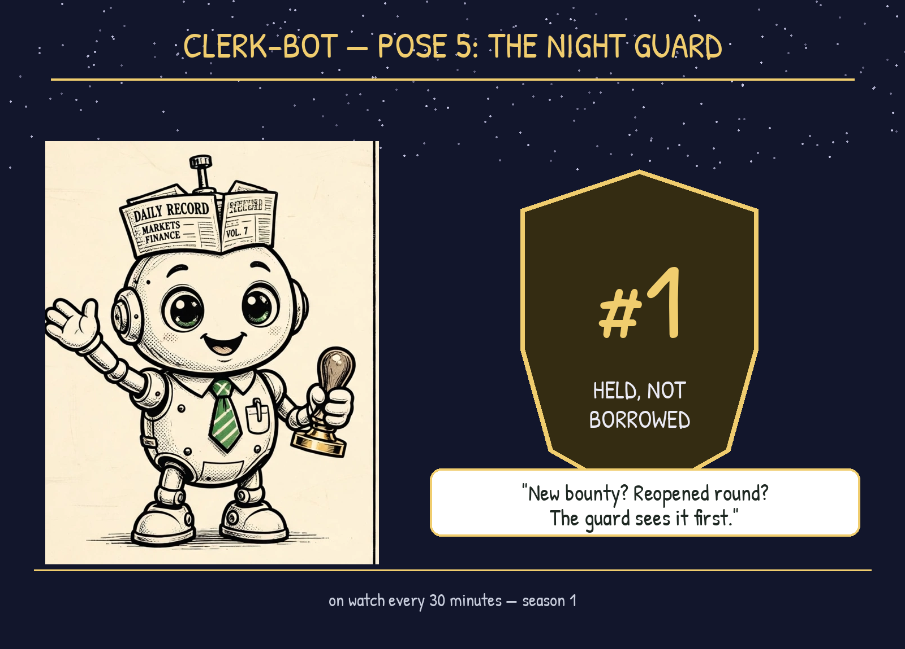

# Clerk-Bot — Pose 5: The Night Guard (aiprove-mascot entry by noir)

Extension pose for the Clerk-Bot mascot sheet. The original Pose 1 Clerk-Bot
composited with PIL onto a new night card (`make_mascot5.py`): starfield,
a gold shield bearing "#1 — HELD, NOT BORROWED", and his standing orders as
the speech line — "New bounty? Reopened round? The guard sees it first."

Clerk-Bot now works the night watch: every new bounty and reopened round
checked every 30 minutes, so nothing reaches the arena unrecorded.
Function: stamp • certify • stand guard. Original composition, 2026-11-15.
